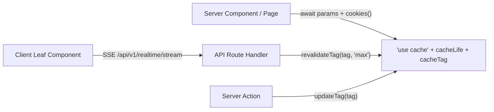

# PlateBeam OS — Full Backend & Frontend Implementation Plan

## Goal Description

Align the production Next.js 16 codebase ([src](file:///home/syed/Workspace/PlateBeam/src)) with the updated [DESIGN.md](file:///home/syed/Workspace/PlateBeam/DESIGN.md) (**Obsidian Command `#09090B` + Beam Orange `#FF5412`** for operations; **Warm Cream `#FAF7F2`** for Guest QR) and close all backend and frontend functional/UI gaps documented in [DESIGN_DIFF_REPORT.md](file:///home/syed/Workspace/PlateBeam/DESIGN_DIFF_REPORT.md).

This plan combines:
1. **Next.js 16 App Router Architecture:** `async` Server Components with `<Suspense>` + `loading.tsx`/`error.tsx`, strict `await` on `params`/`searchParams`/`cookies()`/`headers()`, and explicit `'use cache'` + `cacheLife` + `cacheTag` + `revalidateTag(tag, 'max')` / `updateTag(tag)` invalidation.
2. **Modern Web Guidance:** `dvh`/`dvw` viewport sizing, `content-visibility: auto` + `contain-intrinsic-size` on complex KDS/floor columns for 60FPS INP, native `<dialog>` with `@starting-style`, `popover="manual"` + `ariaNotify()` toasts, `44×44px` coarse pointer targets, and `prefers-reduced-motion`.
3. **Hexagonal Backend Integrity:** Preserving `src/server/core/*.service.ts`, integer minor-unit billing (`*Minor`), HMAC QR tokens, 3-layer RBAC, and IndexedDB delta-sync.

---

## User Review Required

> [!IMPORTANT]
> **Visual Brand Migration (`globals.css` & `layout.tsx`):** This plan replaces the current *Control Tower* palette (`#0B1220` / `#3DE0C5` cyan, Teko/Karla, `rounded-sm`) with the **PlateBeam OS** palette (`#09090B` Obsidian / `#111115` Carbon / `#FF5412` Beam Orange, Inter + JetBrains Mono, `rounded-2xl`/`rounded-3xl` panels) on operations routes, and **Warm Cream (`#FAF7F2`)** on `/t/[qrToken]`.

> [!NOTE]
> **Caching Boundary Rule (Next.js 16):** Because `next.config.ts` enables `cacheComponents: true`, `updateTag(tag)` can **only** be called inside `"use server"` Server Actions, whereas Route Handlers (`src/app/api/v1/**`) **must** use `revalidateTag(tag, 'max')`. Any `cookies()` / `headers()` / `searchParams` reads must stay outside `'use cache'` scopes and be passed as arguments.

---

## Open Questions

1. **Optional `/demo` Split-View Route:** Should we add a dedicated `/demo` route that renders FOH POS / KDS alongside a docked `395px` Guest QR phone simulator (matching the HTML prototype's `Live Split View` for sales/testing demos)?
2. **Demo Currency Display:** The HTML prototype uses `₹` (INR) while seeded `src/` demo data uses `BDT` (`৳`). Should demo mode keep `BDT` (per `PRODUCT.md`) or add a quick currency toggle?

---

## Proposed Changes

### 1. Design System, Typography & Shared UI Primitives

#### [MODIFY] [layout.tsx](file:///home/syed/Workspace/PlateBeam/src/app/layout.tsx)
- Swap Google Fonts from `Teko`, `Karla`, `Share_Tech_Mono` to `Inter` (`--font-inter`, weights `400`–`900`) and `JetBrains_Mono` (`--font-jetbrains-mono`, weights `400`–`700`) via `next/font/google`.
- Default operations shell to dark Obsidian (`#09090B`) while preserving `color-scheme` support.

#### [MODIFY] [globals.css](file:///home/syed/Workspace/PlateBeam/src/app/globals.css)
- Update `@theme inline` and `:root` tokens to Obsidian (`#09090B`), Carbon (`#111115`), Graphite (`#18181F`), Slateborder (`#262630`), Beam Orange (`#FF5412` / `#FF7033`), and Guest Warm Cream (`#FAF7F2`).
- Replace `.tower-field` / `.led-rail` with `.grid-bg` (`36px × 36px` `rgba(255,255,255,0.03)`), `.shadow-beam`, `.animate-halo`, and `.thermal-receipt` (serrated 80mm receipt edge).
- Add `.ops-column-contain` (`content-visibility: auto; contain-intrinsic-size: auto 320px auto 640px;` with `@supports not (content-visibility: auto)` `contain: layout style paint;` fallback) for KDS station columns and POS floor grids.
- Keep `prefers-reduced-motion`, `min-h-dvh`, `env(safe-area-inset-*)`, and `@starting-style` native `<dialog>` / `[popover]` transitions (with `transition-behavior: allow-discrete` declared after `transition`).

#### [MODIFY] [Dialog.tsx](file:///home/syed/Workspace/PlateBeam/src/components/ui/Dialog.tsx) & [ToastRegion.tsx](file:///home/syed/Workspace/PlateBeam/src/components/ui/ToastRegion.tsx)
- Restyle `Dialog.tsx` to `rounded-3xl bg-[#111115] border-white/15` (and light cream variant for Guest dialogs) while keeping native `showModal()` and `closedby="any"`.
- Update `ToastRegion.tsx` positioning (`bottom-20 sm:bottom-4 right-4`) so toasts never occlude fixed mobile/guest bottom navigation bars, keeping `popover="manual"`, `ariaNotify()`, and focus restoration.

---

### 2. Backend Services, API Routes & Next.js 16 Caching (`src/server/` & `src/app/api/v1/`)



#### [MODIFY] [analytics.service.ts](file:///home/syed/Workspace/PlateBeam/src/server/core/analytics.service.ts) & [live/route.ts](file:///home/syed/Workspace/PlateBeam/src/app/api/v1/analytics/outlets/[outletId]/live/route.ts)
- Add `computeHourlyRevenueBuckets(orders, payments)` to `analytics.service.ts` returning hourly `{ hourLabel, amountMinor, orderCount, isCurrentHour }` buckets.
- Extend `GET /api/v1/analytics/outlets/[outletId]/live` response with:
  - `hourlyRevenue` buckets
  - `recentReviews` (guest ratings + `needsRecovery: rating <= 3` flag)
  - `activeShift` summary (`openingFloatMinor`, `cashSalesMinor`, `digitalSalesMinor`, `expectedDrawerMinor`, `status`)

#### [NEW] [kot-preview/route.ts](file:///home/syed/Workspace/PlateBeam/src/app/api/v1/kds/[outletSlug]/tickets/[orderId]/kot-preview/route.ts) & [MODIFY] [escpos.service.ts](file:///home/syed/Workspace/PlateBeam/src/server/core/escpos.service.ts)
- Export a plain-text / structured 80mm thermal line formatter (`formatKotPreviewLines`, `formatBillPreviewLines`) from `escpos.service.ts` so both KDS and POS can render an authentic 80mm `.thermal-receipt` modal without duplicating formatting logic.

#### [MODIFY] [inventory/adjust/route.ts](file:///home/syed/Workspace/PlateBeam/src/app/api/v1/admin/inventory/adjust/route.ts)
- Support `{ mode: 'RESTOCK_ALL', targetQty?: number }` alongside single-item delta adjustments, and call `revalidateTag('inventory', 'max')`.

#### [NEW] [loyalty/redeem/route.ts](file:///home/syed/Workspace/PlateBeam/src/app/api/v1/sessions/[sessionId]/loyalty/redeem/route.ts)
- Validate guest loyalty points threshold (`>= 200 pts`), deduct points, apply a session voucher discount (`discountMinor`), write an audit log, and publish `session.updated` via SSE.

#### [NEW] [cached-queries.ts](file:///home/syed/Workspace/PlateBeam/src/server/queries/cached-queries.ts)
- Implement `'use cache'` query wrappers using `cacheLife('menuCatalog')` + `cacheTag('menu-catalog', ...)` and `cacheLife('analyticsLive')` + `cacheTag('analytics-live', ...)`.
- Call `revalidateTag('menu-catalog', 'max')` in `POST/PATCH /api/v1/admin/menu` and `PATCH /api/v1/admin/menu-items/[itemId]/availability`.

---

### 3. Frontend Surfaces (`src/app/` & `src/components/`)

#### [MODIFY] [page.tsx](file:///home/syed/Workspace/PlateBeam/src/app/page.tsx) & [LoginClient.tsx](file:///home/syed/Workspace/PlateBeam/src/components/auth/LoginClient.tsx)
- Restyle Home `/` in Obsidian `.grid-bg` + Beam Orange `shadow-beam` CTAs and `rounded-2xl` channel strips (`CH-01`–`CH-05`, plus optional `/demo` link).
- Restyle `LoginClient.tsx` keypad and demo staff cards to Carbon `#111115` + Beam Orange active focus states.

#### [MODIFY] [dashboard/page.tsx](file:///home/syed/Workspace/PlateBeam/src/app/dashboard/page.tsx) & [OwnerDashboardClient.tsx](file:///home/syed/Workspace/PlateBeam/src/components/ops/OwnerDashboardClient.tsx)
- Add `loading.tsx` and `error.tsx` boundaries; pass initial cached snapshot from Server Component into `OwnerDashboardClient`.
- **Overview Tab:** Add **Hourly Service Revenue Bar Chart**, **Payment Mix stacked progress bar**, **Shift Register & Z-Report card**, and **Guest Reviews & Service Recovery Queue** alongside the existing 4-Quadrant Menu Engineering Matrix.
- **Menu & 86 Tab:** Add **`+ Add Menu Item` `<Dialog>`** wired to `POST /api/v1/admin/menu`.
- **Inventory Tab:** Add visual stock progress bars and **`Restock All`** button wired to `POST /api/v1/admin/inventory/adjust`.
- **Header:** Add Outlet Switcher dropdown backed by `/api/v1/admin/outlets`.

#### [MODIFY] [PosFloorClient.tsx](file:///home/syed/Workspace/PlateBeam/src/components/ops/PosFloorClient.tsx)
- Add **`Kitchen Pass & Bar Counter`** spatial header above the `.grid-bg` floor grid.
- Add persistent **Selected Table Inspector** panel (`Rotate QR`, `Print Bill` thermal preview modal, `Clear Table`, `Claim & Resolve Help`).
- Add **`+ Waiter POS Order` `<Dialog>`** to fire assisted orders directly to KDS for any table.
- Apply `.ops-column-contain` to the floor grid and restyle table status cards (`VACANT`, `ORDERING`, `EATING`, `CALLING_WAITER`, `BILL_REQUESTED`, `CLEANING`) to Obsidian/Beam Orange semantics.

#### [MODIFY] [KdsConsoleClient.tsx](file:///home/syed/Workspace/PlateBeam/src/components/ops/KdsConsoleClient.tsx)
- Add view-mode toggle between **3-Column Station Board** (`Tandoor`, `Curry`, `Drinks`) and **All-Tickets Grid**, applying `.ops-column-contain` to each station column.
- Add **Thermal KOT Preview (`🖨️`)** modal button per ticket and **`+ Simulate Rush KOT`** demo helper.
- Preserve keyboard bump shortcuts (`1–9`, `Space`, `R`), allergen badges, companion stations, and Manager PIN cancel dialog.

#### [MODIFY] [GuestPortalClient.tsx](file:///home/syed/Workspace/PlateBeam/src/components/guest/GuestPortalClient.tsx), [MenuBrowser.tsx](file:///home/syed/Workspace/PlateBeam/src/components/guest/MenuBrowser.tsx), [WaitExperienceCard.tsx](file:///home/syed/Workspace/PlateBeam/src/components/guest/WaitExperienceCard.tsx), [CallWaiterDialog.tsx](file:///home/syed/Workspace/PlateBeam/src/components/guest/CallWaiterDialog.tsx)
- Style guest surface with **Warm Cream (`#FAF7F2`)** ground, crisp white `rounded-2xl` cards, and Beam Orange (`#FF5412`) CTAs.
- Add **QR Session Rotated** recovery state when bootstrap returns `QR_ROTATED` / `401`.
- Add **Loyalty Voucher Redeem** button in `WaitExperienceCard.tsx` wired to `POST /api/v1/sessions/[sessionId]/loyalty/redeem`.
- Add `.animate-halo` pulse to the `Call Waiter` CTA and thermal GST receipt preview formatting in `ReceiptReviewDialog.tsx`.

#### [NEW] [demo/page.tsx](file:///home/syed/Workspace/PlateBeam/src/app/demo/page.tsx) *(Pending Open Question #1)*
- Optional split-view simulator route pairing FOH POS / KDS / Owner BI on the left (`xl:col-span-8`) with a docked `395px` Guest QR iframe on the right (`xl:col-span-4`).

---

## Verification Plan

### Automated Tests
Run the full verification suite after implementation:
```bash
npm run typecheck
npm run lint
npm test
npm run build
```

### Manual & Browser Verification
1. Start the app (`npm run dev`) and inspect all routes at **1440×900**, **768×1024**, and **390×844** using the browser subagent:
   - `/` (Obsidian `.grid-bg`, Beam Orange CTAs, channel links)
   - `/login` (PIN `1234`/`2222`/`4444` and Email auth)
   - `/t/<seeded-qr>` (Warm Cream menu, modifier sheet, upsell, shared cart, Wait countdown + Wi-Fi + Loyalty redeem + Spice Quiz, Call Waiter, 3-mode Split Bill, GST Receipt & Review)
   - `/pos/zaika-bistro` (Table Inspector, `+ Waiter POS Order`, `Rotate QR`, `Print Bill` thermal modal, layout drag-and-drop)
   - `/kds/zaika-bistro` (3-column station board, SLA timers, `Print KOT` thermal modal, bump & `R` recall)
   - `/dashboard` (KPIs, Hourly Revenue bar chart, Payment Mix bar, Menu Engineering, `+ Add Menu Item`, `Restock All`, Reviews recovery queue, RBAC & Audit)
   - `/admin` (Tenant search, provisioning, status toggle)
2. Verify zero console/hydration errors, zero toast overlap with bottom bars, and `44×44px` minimum touch targets on mobile.
