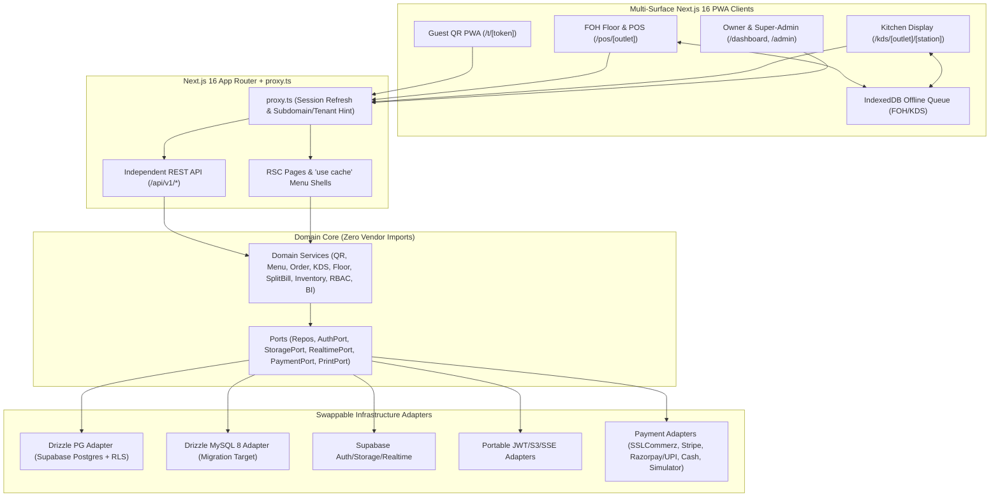

# PlateBeam — Complete End-to-End Implementation Plan

## Goal Description

Build **PlateBeam**, a multi-tenant cloud Restaurant Management & QR Ordering SaaS implementing the complete [SRS specification](file:///home/syed/Workspace/PlateBeam/Complete%20End-to-End%20SRS_%20Restaurant%20Management%20%26%20QR%20Ordering%20Software.md) (`FR-001`–`FR-036`, `NFR-001`–`NFR-010`, and all 25 core database tables) on **Next.js 16 (`16.4.6`) App Router** and **Supabase**, while decoupling all business logic behind an **independent `/api/v1/*` REST API** and **hexagonal Ports & Adapters** so the entire backend can migrate cleanly from **Supabase (PostgreSQL + Auth + Storage + Realtime)** to **MySQL 8+ (with JWT/Argon2id + S3 + SSE/Redis)** without rewriting domain services, API contracts, or frontend UI.

### Key Verified Research Findings
- **Next.js 16 (`16.4.6`):** Turbopack is the default bundler; `proxy.ts` replaces `middleware.ts` as the lightweight network boundary; explicit `'use cache'` + `cacheLife` + `cacheTag` + `updateTag()` (under `experimental.cacheComponents: true`) replaces implicit caching; `params`, `searchParams`, `cookies()`, and `headers()` are strictly async.
- **Supabase Integration:** `@supabase/ssr` cookie session handling with `supabase.auth.getClaims()` / `getUser()` (never trusting `user_metadata` for authorization); `FORCE ROW LEVEL SECURITY` on all tenant tables in exposed schemas or server-only access with `SET LOCAL app.tenant_id`; `supabase_mcp` currently shows organization `syed-reza98` (`id: lycmwfexrbzmsxaajizz`) with `0` active projects.
- **Database Portability (Supabase Postgres → MySQL):** Using **Drizzle ORM** with parallel dialect schemas (`pgTable` and `mysqlTable` sharing identical TypeScript domain DTOs/Zod schemas), `BIGINT` minor currency units (poisha/paise/cents), UUID string primary keys (`CHAR(36)` in MySQL / `UUID` in PG), and abstract `Repository` interfaces eliminates `.returning()` vs `insertId`, JSONB vs JSON, and `TEXT[]` vs JSON-array friction.
- **Modern Web Guidance & PWA Performance:** Native `<dialog>` (`showModal()` + `overscroll-behavior: contain`), `popover="manual"` stackable toasts + `aria-live` fallback, `@container`-driven responsive data tables, `light-dark()` + `prefers-color-scheme` + `forced-colors` color tokens, `44×44` touch targets for coarse pointers, `dvh`/`env(safe-area-inset-*)` mobile spacing, `fetchpriority="high"` LCP food imagery, and `IndexedDB` (`idb`) + `StorageManager.persist()` for offline POS/KDS resilience.

---

## User Review Required

> [!IMPORTANT]
> **Supabase Project Provisioning:** Upon your approval of this plan, I will create a new Supabase project under your `syed-reza98` organization via Supabase MCP, automatically populate `.env.local`, push the 25-table PostgreSQL + RLS schema migrations, and run Supabase Security/Performance Advisors (`get_advisors`).

> [!NOTE]
> **Database & Vendor Portability Trade-Off:** Because you want **Supabase today** with clean **MySQL migration later**, client React components will **never** import `@supabase/supabase-js` for database queries. Instead:
> 1. All reads/writes flow through `/api/v1/*` Route Handlers (or Next.js Server Actions calling the same `src/server/core/*` services) → `Repository` interfaces → `PostgresDrizzleAdapter` (today) or `MySqlDrizzleAdapter` (future).
> 2. **Auth (`AuthPort`):** `@supabase/ssr` handles session auth today; a self-contained `JwtArgonAuthAdapter` (using our `users` table + POS PIN hashes) is built into the port contract for MySQL mode.
> 3. **Realtime (`RealtimePort`):** Server services emit domain events (`order.created`, `kds.updated`, `table.updated`, `waiter.called`, `cart.synced`, `game.tick`) through `RealtimePort`. Today it dispatches via **Supabase Realtime Broadcast**; for MySQL/self-hosted mode, an **SSE (`/api/v1/realtime/stream`) + EventBus** adapter implements the exact same contract.
> 4. **Payments (`PaymentPort`):** Ships with concrete adapters for **SSLCommerz** (ready for your sandbox credentials), **Stripe**, **Razorpay/UPI**, **Venue Cash/EDC**, and a built-in **Interactive Sandbox Simulator** when gateway env vars are not yet set.

---

## Architecture Blueprint

### 1. System & Hexagonal Ports Architecture

### 2. Visual Identity & Design System: "Warm Editorial Bistro + Obsidian Kitchen"

- **Typography (`next/font/google`):**
  - Display Headings (Guest Menu & Brand): `Instrument Serif`
  - UI & Body Copy: `Plus Jakarta Sans`
  - Numerical / KDS Timers / Receipts / Currency: `JetBrains Mono` with `font-variant-numeric: tabular-nums`
- **Adaptive Color Tokens (OKLCH + Hex fallbacks + `light-dark()` + `prefers-color-scheme` + `@media (forced-colors: active)`):**
  - **Guest & Owner Light:** Canvas `#FBF9F5` (Warm Alabaster), Elevated Card `#FFFFFF`, Warm Stone Border `#E6DFD3`, Ink `#1B1714`, Muted `#6B6056`.
  - **Guest & Owner Dark:** Canvas `#171311` (Deep Espresso), Elevated Card `#231D1A`, Border `#382E29`, Ink `#F7F3ED`, Muted `#B5A89B`.
  - **Brand & Semantic Accents:** Saffron Ember `#E05A2B` (primary CTA), Herb Olive `#3A6B35` (veg/available/ready), Turmeric Gold `#D99B26` (warning/amber SLA/bill requested), Crimson Chili `#C93B2B` (alert/overdue/allergen).
  - **Dedicated KDS Surface (`color-scheme: dark` scoped):** Deep Charcoal `#111315`, Ticket Card `#1B1E23`, high-contrast status bars (Green On-Time `#2D8A56`, Amber >75% SLA `#E5A93C`, Pulsing Crimson Overdue `#E04F44`) paired with explicit status badges/icons (never color-only per WCAG 1.4.1).

---

## Proposed Changes

### Component 1: Project Scaffolding, Next.js 16 Config & Design System

Initialize a clean Next.js `16.4.6` TypeScript workspace with Tailwind CSS v4, Zod, Drizzle ORM, `@supabase/ssr`, `idb`, `qrcode`, `lucide-react`, `vitest`, and `@playwright/test`.

#### [NEW] [package.json](file:///home/syed/Workspace/PlateBeam/package.json)
- Scripts: `dev` (Turbopack), `build`, `start`, `lint`, `typecheck`, `test` (`vitest`), `test:e2e` (`playwright`), `db:generate:pg`, `db:generate:mysql`, `db:migrate`, `db:seed`.
#### [NEW] [next.config.ts](file:///home/syed/Workspace/PlateBeam/next.config.ts)
- Enable `experimental: { cacheComponents: true }`, configure custom `cacheLife` profiles (`menuCatalog`, `analyticsLive`), and remote image patterns for Supabase Storage / S3.
#### [NEW] [src/proxy.ts](file:///home/syed/Workspace/PlateBeam/src/proxy.ts)
- Next.js 16 `export async function proxy(request: NextRequest)` replacing `middleware.ts`: refreshes Supabase auth cookies via `AuthPort` session helper, attaches `x-trace-id`, resolves optional tenant subdomain slug header, and protects `/dashboard`, `/pos`, `/kds`, `/admin` routes without running heavy DB queries.
#### [NEW] [src/app/layout.tsx](file:///home/syed/Workspace/PlateBeam/src/app/layout.tsx)
- Root layout loading `Instrument_Serif`, `Plus_Jakarta_Sans`, `JetBrains_Mono`, `<meta name="color-scheme" content="light dark">`, `<meta name="viewport" content="width=device-width, initial-scale=1, viewport-fit=cover">`, PWA manifest link, and global persistent toast region (`role="region"` + `popover="manual"` + `aria-live` fallback).
#### [NEW] [src/app/globals.css](file:///home/syed/Workspace/PlateBeam/src/app/globals.css)
- Design tokens (`light-dark()`, `prefers-color-scheme` fallbacks, `@media (forced-colors: active)` overrides), `44px` coarse-pointer target floor, `env(safe-area-inset-*)`, `scroll-padding-bottom`, native `dialog:modal` + `dialog::backdrop` `overscroll-behavior: contain`, `@container`-driven `.responsive-table` card stacking, and `prefers-reduced-motion` guards.

---

### Component 2: Portable Multi-Dialect Database Layer (25 Tables: Supabase PG + MySQL 8)

Design the complete 25-table schema from SRS Section 4.1 in both PostgreSQL (`src/server/db/schema/pg/`) and MySQL (`src/server/db/schema/mysql/`) with unified TypeScript domain types and Zod contracts.

**All 25 Tables Covered:**
1. `tenants`, `outlets`, `users`, `roles`, `user_permission_overrides` (RBAC & multi-tenancy)
2. `floor_zones`, `dining_tables`, `kitchen_stations` (floor & kitchen topology)
3. `menu_categories`, `menu_items`, `item_variants_modifiers`, `upsell_rules`, `tax_slabs` (menu, modifiers, upsells, GST/VAT)
4. `guests`, `table_sessions`, `orders`, `order_items`, `service_requests` (dining lifecycle)
5. `invoices`, `payments`, `reviews`, `mini_game_sessions` (billing, reviews, gamification)
6. `inventory_items`, `menu_item_recipes`, `audit_logs` (BOM inventory & immutable compliance trail)
*(Plus `shift_registers` table to fully support `FR-035` cashier opening float, petty cash, and Z-Report reconciliation).*

**Portability Rules Enforced:**
- Monetary columns: `BIGINT` minor units (`base_price_minor`, `amount_minor`, `tip_minor`, etc.).
- UUIDs generated in application layer (`crypto.randomUUID()`) so inserts never depend on PG `RETURNING` vs MySQL `insertId`.
- PG `JSONB` ↔ MySQL `JSON`; PG `TEXT[]` (`allergens`, `spice_levels`, `tags`) modeled cleanly as JSON arrays in MySQL and mapped to `string[]` in the repository layer.
- **PostgreSQL RLS (`supabase/migrations/0002_rls_policies.sql`):** `ENABLE` + `FORCE ROW LEVEL SECURITY` on every tenant-scoped table using `RESTRICTIVE` `tenant_isolation_policy` checking `tenant_id = NULLIF(current_setting('app.tenant_id', true), '')::uuid`, plus transaction wrapper executing `SET LOCAL app.tenant_id = ...`. Every repository method *also* explicitly filters `WHERE tenant_id = ?` so tenant isolation works identically on MySQL!

#### [NEW] [src/server/db/client.ts](file:///home/syed/Workspace/PlateBeam/src/server/db/client.ts)
- Factory reading `DB_DIALECT` (`postgres` default for Supabase, `mysql` for MySQL 8+) and exposing `withTenantTx(tenantId, fn)`.
#### [NEW] [src/server/db/schema/pg/index.ts](file:///home/syed/Workspace/PlateBeam/src/server/db/schema/pg/index.ts)
- Full 26-table Drizzle PostgreSQL schema with composite `(tenant_id, ...)` indexes.
#### [NEW] [src/server/db/schema/mysql/index.ts](file:///home/syed/Workspace/PlateBeam/src/server/db/schema/mysql/index.ts)
- Mirror Drizzle MySQL 8+ schema (`mysqlTable`, `char(..., { length: 36 })`, `bigint`, `json`) verified by schema-parity unit tests.
#### [NEW] [supabase/migrations/0001_schema.sql](file:///home/syed/Workspace/PlateBeam/supabase/migrations/0001_schema.sql)
#### [NEW] [supabase/migrations/0002_rls_policies.sql](file:///home/syed/Workspace/PlateBeam/supabase/migrations/0002_rls_policies.sql)

---

### Component 3: Hexagonal Ports, Adapters & Independent `/api/v1/*` Backend

Every backend concern lives behind pure TypeScript interfaces in `src/server/ports/` and business services in `src/server/core/`, exposed over versioned `/api/v1/*` Route Handlers with OpenAPI 3.1 schema generation (`zod-to-openapi` or typed route registry).

#### [NEW] `src/server/ports/`
- `auth.port.ts` (`AuthPort`: `getSessionClaims`, `requireStaff`, `verifyPosPin`, `signIn`, `signOut`)
- `storage.port.ts` (`StoragePort`: `uploadMenuAsset`, `uploadInvoicePdf`, `getSignedUrl`, `deleteObject`)
- `realtime.port.ts` (`RealtimePort`: `publishToFloor`, `publishToStation`, `publishToTableSession`, `publishToMenu`)
- `payment.port.ts` (`PaymentPort`: `initiatePayment`, `verifyWebhook`, `verifyTransaction`, `refundTransaction`)
- `repositories.port.ts` (Repository interfaces for Tenant/Outlet, Menu, Session/Order, KDS, Floor/Service, Billing/Payment, Inventory, Analytics, Audit)

#### [NEW] `src/server/adapters/`
- `supabase/auth.adapter.ts` (`@supabase/ssr` using `getClaims()` + `app_metadata` + staff DB role lookup)
- `supabase/storage.adapter.ts` (Supabase Storage buckets `menu-media` & `invoices`)
- `supabase/realtime.adapter.ts` (Supabase Realtime Broadcast over REST/client channels)
- `portable/jwt-auth.adapter.ts` & `portable/sse-realtime.adapter.ts` (drop-in replacements for MySQL/self-hosted mode + `/api/v1/realtime/stream` SSE endpoint)
- `payments/sslcommerz.adapter.ts` (SSLCommerz v4 Session Init + IPN/Validation API verifier ready for sandbox credentials)
- `payments/stripe.adapter.ts`, `payments/razorpay.adapter.ts`, `payments/cash-edc.adapter.ts`, `payments/sandbox.adapter.ts`

#### [NEW] `src/server/core/` (Domain Services)
- `rbac.service.ts`: Computes `(Role Defaults + Explicit Grants) - Explicit Denials` (`DENY` always wins) + writes immutable `audit_logs`.
- `qr-security.service.ts`: HMAC-SHA256 signed non-sequential `qr_token`, one-tap rotation, Haversine GPS geofence (`<=100m`), venue IP check, blocklist, max unpaid order cap, Captain Approval mode, Pay-First takeaway token generator.
- `menu.service.ts`: Categorized menu, dietary/allergen/spice filters, time-window scheduling (`Breakfast/Lunch/Happy Hour`), upsell pairing engine, real-time 86 toggle.
- `order-kds.service.ts`: Multi-round running tab ordering, atomic stock check & BOM inventory auto-deduction (with auto-86 on zero stock), station splitting, KDS state machine (`PENDING -> ACCEPTED -> PREPARING -> READY -> SERVED`, manager PIN for `CANCELLED` once `PREPARING`), recall last bumped, ESC/POS byte-buffer generator (`58mm`/`80mm` + RJ11 drawer kick).
- `billing.service.ts`: Exact integer minor-unit tax slab calculation (inclusive/exclusive CGST+SGST or VAT + service charge), Split-Bill engine (**Equal** with largest-remainder minor-unit distribution, **By Item** with shared dish fractions, **Custom Amount**), pre-tax tip pooling, idempotent payment ledger & duplicate-charge reconciliation flag, sequential statutory invoice & PDF/HTML receipt generator.
- `engagement.service.ts`: Live cook countdown derived from station queue depth, Guest Wi-Fi card, Loyalty points/tiers/vouchers, *Spice Quiz* multiplayer game state & daily high-score coupon rewards, post-meal 5-star review routing (4–5★ → Google Review CTA; 1–3★ → private feedback + immediate manager alert).
- `analytics.service.ts`: Live Owner KPIs, Menu Engineering matrix (Stars, Plowhorses, Puzzles, Dogs), Shift Register Z-Reports, CSV/PDF exports.

#### [NEW] `src/app/api/v1/**` (Independent REST API Endpoints)
- `GET /api/v1/health` (DB dialect & adapter diagnostics)
- `GET /api/v1/openapi.json` (Auto-generated OpenAPI 3.1 spec from Zod schemas)
- `GET /api/v1/public/qr/[qrToken]/bootstrap`
- `POST /api/v1/sessions/[sessionId]/cart` & `POST /api/v1/sessions/[sessionId]/orders`
- `POST /api/v1/sessions/[sessionId]/service-requests` & `PATCH /api/v1/service-requests/[id]/claim`
- `POST /api/v1/sessions/[sessionId]/split-bill/calculate`
- `POST /api/v1/sessions/[sessionId]/payments/initiate`
- `POST /api/v1/webhooks/payments/[provider]` (SSLCommerz IPN / Stripe / Razorpay / Sandbox)
- `GET /api/v1/invoices/[invoiceId]/receipt` (HTML/PDF statutory receipt)
- `POST /api/v1/sessions/[sessionId]/reviews` & `POST /api/v1/sessions/[sessionId]/games`
- `PATCH /api/v1/kds/order-items/[itemId]/status` & `POST /api/v1/kds/tickets/[orderId]/recall`
- `GET /api/v1/print-bridge/jobs` (for local ESC/POS print daemon)
- `POST /api/v1/floor/tables/[tableId]/operations` (merge, transfer, split, reset, QR rotate)
- `POST /api/v1/sync/delta` (idempotent offline FOH/KDS queue reconciliation)
- `GET /api/v1/analytics/outlets/[outletId]/live` & `/reports` & `/shifts`
- CRUD endpoints for `/api/v1/admin/*` (Menu, Recipes/Inventory, Staff/RBAC, Tax Slabs, Upsells, Outlets, Super-Admin Tenants)

---

### Component 4: Responsive Multi-Surface Frontend (Next.js 16 App Router + PWA)

#### 1. Guest Zero-App QR Portal (`/t/[qrToken]`)
- Mobile-first (`320px+` safe, `dvh`, thumb-zone sticky cart bar, safe-area padding), `'use cache'` catalog shell + Suspense streaming for live session.
- **Interactive Menu:** Sticky category tabs, dietary pills (Veg, Vegan, GF, Jain), allergen warning badges, spice selector, portion/modifier drawer, upsell strip ("Pair with Garlic Naan").
- **Shared Table Cart & Multi-Round Tab:** Live collaborative cart across tablemates, Captain Review / Pay-First indicators, running multi-round order history.
- **Wait-Time Experience:** Real-time cook countdown timer, 1-tap Guest Wi-Fi Password Copy & QR card, Loyalty points badge, and live multiplayer **Spice Quiz** mini-game modal (`<dialog>`).
- **Call Waiter & Checkout:** Persistent 1-tap Call Waiter sheet (`Water`, `Napkins`, `Cutlery`, `Clean Table`, `Request Bill`, `Need Assistance`) with cooldown timer; 2-tap **Split Bill** (Equal / Item-wise / Custom) + Tipping + SSLCommerz / Card / UPI / Cash checkout; instant statutory digital receipt + 5-star review prompt.

#### 2. FOH Staff Floor Map & POS (`/pos/[outletSlug]`)
- Fast 4/6-digit Staff PIN switcher (`verifyPosPin`), tablet/phone responsive grid.
- **Live Color-Coded Floor Map:** Zones (Main Hall, Patio, VIP, Bar), draggable table layout editor + live status tiles (Gray Vacant, Blue Ordering, Green Eating, Flashing Red + Chime Call Waiter with claim button, Amber Bill Requested).
- **Assisted POS & Operations:** Captain Order Approval queue, Counter/Takeaway Token issuer (`Token #42`), Table Merge/Split/Transfer dialog, Cashier Shift Float & Z-Report modal, Offline IndexedDB banner & auto Delta-Sync indicator.

#### 3. Kitchen Display System (`/kds/[outletSlug]`)
- Dedicated high-contrast Obsidian Charcoal (`#111315`) console with station tabs (All / Tandoor / Curry / Drinks / Bar).
- Ticket cards with massive Table/Token numbers, bold allergy/modifier callouts, companion-station indicators, live `JetBrains Mono` elapsed timers transitioning Green → Amber → Pulsing Crimson, `48×48px+` touch buttons + keyboard bump-bar shortcuts (`1–9`, `Space`, `R` to recall), Web Audio chime on new KOT, and offline IndexedDB ticket cache.

#### 4. Owner Command Center & Platform Super-Admin (`/dashboard` & `/admin`)
- Live KPI cards (`6/6 Tables`, Live Orders, Net Sales, AOV, Avg Turnover, KDS Prep SLA, Payment Mix).
- Responsive `@container` tables for Menu & 86 Toggle, Recipe BOM & Low-Stock Alerts, Staff & 3-Layer RBAC Matrix (`Role` + `Grant`/`Deny` overrides + Audit Logs), QR Security & Geofence settings, Tax Slabs, Upsell Rules, Menu Engineering Matrix (Stars/Plowhorses/Puzzles/Dogs), CSV/PDF BI Exports, and Super-Admin Tenant Provisioning.

#### 5. Optional Companion Local ESC/POS Print Bridge (`scripts/print-bridge.ts`)
- Lightweight Node.js script polling/subscribing to `/api/v1/print-bridge/jobs` and dispatching raw ESC/POS byte commands (`58mm`/`80mm` KOTs, Bills, RJ11 cash drawer pulse) over TCP Port 9100 / USB, plus browser print fallback in the POS UI.

---

### Phased Execution Roadmap (4 Vertical Milestones)

1. **Phase 1 — Foundation, Supabase Setup, Portable DB, Auth/RBAC & Core Guest/Floor Loop:**
   - Scaffold Next.js `16.4.6` app, design tokens, `proxy.ts`, Supabase project provisioning via MCP, 26-table PG + MySQL Drizzle schemas, RLS policies, seed script (demo tenant "Zaika Bistro" with BDT/INR/USD tax & menu sample), `AuthPort` + 3-layer RBAC, Signed QR + Anti-Spoofing, Guest Menu/Cart/Order, and FOH Live Floor Map.
2. **Phase 2 — KDS, ESC/POS Print Bridge, Call Waiter, Split-Bill, SSLCommerz & Receipts:**
   - Station-routed KDS with live timers/chimes/bump/recall, ESC/POS generator & local print bridge, Call Waiter SLA alerts, Table Merge/Transfer/Split, Split-Bill engine, `PaymentPort` (SSLCommerz + Stripe/Razorpay/Cash + Simulator), idempotent webhooks, and statutory PDF/HTML receipts.
3. **Phase 3 — Wait Experience, Loyalty, Spice Quiz Mini-Game, Inventory BOM, BI & Offline Sync:**
   - Cook countdown, Wi-Fi copy card, Loyalty wallet & vouchers, Multiplayer *Spice Quiz* via `RealtimePort`, 5-star review routing, Recipe BOM inventory auto-deduction & auto-86, Shift Register Z-Reports, Menu Engineering BI, and IndexedDB Delta-Sync for FOH/KDS.
4. **Phase 4 — Verification, Security Audit, Performance & Production Readiness:**
   - Full unit/integration/RLS/MySQL-parity test suite, Playwright multi-context E2E tests (Guest 1 + Guest 2 + KDS + Floor), Lighthouse/CWV optimization, Supabase `get_advisors` security/performance audit, and Production Go-Live documentation.

---

## Verification Plan

### Automated Tests
1. **Typecheck & Lint:** `npm run typecheck && npm run lint`
2. **Unit & Financial/Security Logic Tests (`vitest run`):**
   - `billing.test.ts`: Exact minor-unit tax slab calculations (inclusive/exclusive CGST+SGST, VAT), Split-Bill remainder distribution (`sum(splits) === total_minor`, 0 rounding drift), pre-tax tip calculation.
   - `rbac.test.ts`: 3-layer permission resolution verifying `DENY` overrides `GRANT` and role defaults, plus `audit_logs` emission.
   - `qr-security.test.ts`: HMAC token tamper rejection (HTTP 403), QR rotation invalidating old tokens, geofence Haversine check, cooldown enforcement.
   - `db-portability.test.ts`: Verifies PG and MySQL Drizzle schemas share identical entity keys/columns and repository contract tests pass against both dialects.
3. **Multi-Tenant RLS Isolation Tests:** Automated test against provisioned Supabase Postgres verifying Tenant A cannot read/update Tenant B rows even on raw queries.
4. **End-to-End Flow Tests (`npx playwright test`):** Multi-context browser simulation (Guest 1 mobile + Guest 2 mobile + KDS dark console + FOH Floor tablet) covering QR scan → shared cart → multi-round order → KDS bump → Call Waiter claim → Split-Bill sandbox payment → Digital Receipt + Review.
5. **Production Build & Security Advisors:** `npm run build` + Supabase MCP `get_advisors` (zero critical security/RLS warnings).

### Manual Verification
1. Inspect responsive layouts across `360px` mobile (Guest QR), `768px–1024px` tablet (FOH Floor & KDS), and `1440px` desktop (Owner Command Center) in both light and dark modes.
2. Verify SSLCommerz sandbox checkout flow once you supply sandbox Store ID & Store Password credentials.
3. Verify offline queue recovery by toggling browser offline mode on FOH/KDS, submitting/bumping orders, reconnecting, and confirming Delta-Sync reconciliation.
